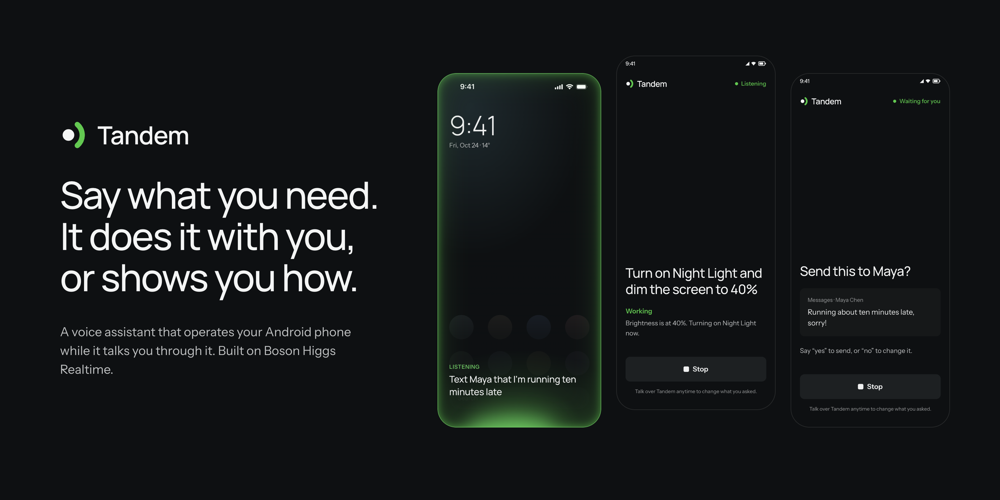
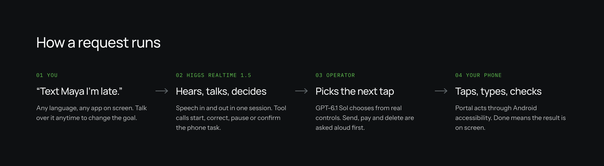
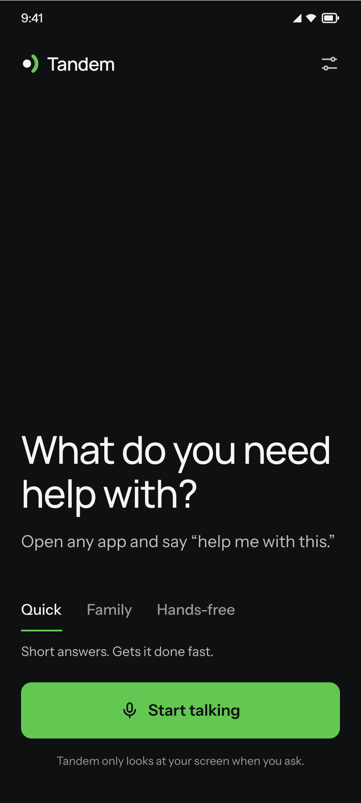
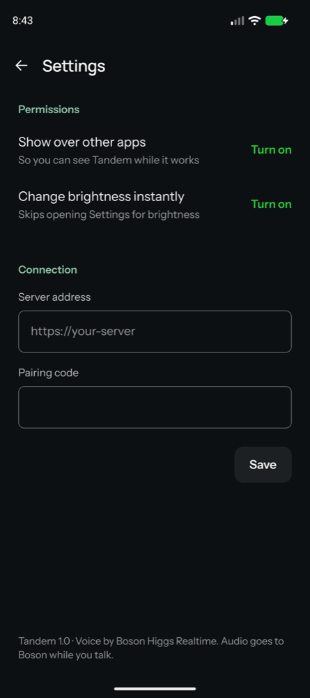

<p align="center">
  <a href="https://github.com/Ron-it/boson-hack-26/releases/latest/download/tandem.apk"><b>Download the APK</b></a>
  &nbsp;·&nbsp;
  <a href="#quickstart">Quickstart</a>
  &nbsp;·&nbsp;
  <a href="#how-higgs-audio-is-used">Higgs Audio</a>
  &nbsp;·&nbsp;
  <a href="#known-limitations">Limitations</a>
</p>

Tandem is an Android voice assistant for people who know what they want but get
lost in apps. Say the goal in your own words and Tandem operates the phone while
it talks you through it. Ask "show me how" and it guides you instead. Talk over
it anytime to correct it, pause it, or take over.



## How Higgs Audio is used

| Higgs | What it does in Tandem |
| --- | --- |
| **Higgs Realtime 1.5** <br><sub>`higgs-realtime-1.5-preview`</sub> | The whole conversation in one session. It hears you, speaks back, and drives the phone through eight tools: start or correct a task, look at the screen, confirm, guide mode, pause, continue, stop, and instant actions. |
| **Higgs STT 3.1** <br><sub>`higgs-stt-3.1`</sub> | Transcribes your words so a "yes, send it" only counts if you actually said it. |
| **Voice cloning** | Family mode speaks in a cloned voice. In Settings, the helper picks a language, reads a short paragraph aloud, and the controller clones it with Boson's voice API, so a parent hears help in their own child's voice. |
| **Voice presets** | **Quick** for fast turn-taking. **Family** is warm, slower, and always speaks its chosen language (Hindi, English, Spanish, French, German or Mandarin). **Hands-free** never asks you to touch the screen. |

Your voice interrupts everything: speech cancels in-flight phone work, flushes
playback, and the corrected goal replaces the old one. Sending, paying and
deleting are always asked aloud first.

## Quickstart

You need an Android phone (Android 12+), a [Boson API key](https://docs.boson.ai)
and an OpenAI API key. About ten minutes.

**1. Deploy your controller**

[](https://render.com/deploy?repo=https://github.com/Ron-it/boson-hack-26)

Paste your two API keys. Render generates the `DEVICE_TOKEN` pairing code; copy
it from the service's Environment tab along with the service URL.

**2. Install two apps on the phone**

- [Tandem APK](https://github.com/Ron-it/boson-hack-26/releases/latest/download/tandem.apk) (allow installs from your browser when asked)
- [Mobilerun Portal APK](https://github.com/droidrun/mobilerun-portal/releases), which lets Tandem tap and type

**3. Pair**

| Portal | Tandem |
| --- | --- |
| Turn on its accessibility service. In **Settings → Reverse Connection**, set the host to `wss://<your-service>.onrender.com/device`, paste the token, and turn on **Connect to Host**. | Tap **Pair this phone**, enter `https://<your-service>.onrender.com` and the same token. Optionally allow brightness control and drawing over other apps. |

**4. Talk**

Pick a voice, tap **Start talking**, and try the lines below. For **Family**,
first open Settings → **Family voice**, pick a language and read the paragraph
aloud, so help comes in your voice.

> "Set brightness to 70% and turn on Night Light." … "Actually, leave Night Light off."<br>
> "Text Maya that I'm running late."<br>
> "Set a timer for ten minutes."<br>
> "What is this screen asking me?"<br>
> "Show me how to turn on Wi-Fi."

<p>
  
  
</p>

<details>
<summary><b>Run the controller locally or build the APK yourself</b></summary>

```sh
cp .env.example .env   # BOSON_API_KEY, OPENAI_API_KEY, DEVICE_TOKEN (random, 24+ chars)
npm install
npm start              # PORT, default 3000. GET /health shows if the phone is connected
```

Expose it over HTTPS (any tunnel or host works; the `Dockerfile` is what we run).
`npm run voice:check` runs a synthetic Higgs session without a phone.
`npm test` and `npm run typecheck` run the controller checks.

Your own Family voice: Settings > Family voice on the phone. To set a fallback for
phones without one, `bash scripts/family-voice.sh` records Hindi, clones it with
Boson and saves `FAMILY_VOICE=voice_<id>`. Set the same variable on your controller.

Build the APK (JDK 17 and the Android SDK; Expo Go does not work):

```sh
npm --prefix mobile ci
cd mobile
npx expo prebuild --platform android --no-install
./android/gradlew -p android assembleRelease -PreactNativeArchitectures=arm64-v8a
```

</details>

## Under the hood

```text
Tandem app      Expo screen + Kotlin foreground service (mic, speaker, rim overlay)
    ↕           authenticated WSS, PCM16 24 kHz
Controller      Node, holds the Higgs Realtime session and the API keys
    ↕           each step chosen by GPT-6.1 Sol from the live accessibility tree
Portal          Android accessibility: tap, type, scroll, read the screen
```

Instant actions (home, back, open an app or link) skip the model. Timers, alarms,
exact volume and brightness go through Tandem's native module. Everything else
reads the screen, acts, and verifies: a sent message is only done when its bubble
shows as sent.

`mobile/` app · `mobile/modules/boson-audio/` native audio and overlay ·
`src/server/` controller (`voice.ts` is the Higgs session) · `src/mobile/` Portal
client and operator

## Known limitations

- One phone and one voice session per controller. No accounts or task history.
- Render's free plan sleeps when idle; the first connection can take a minute.
- A controller redeploy ends the voice session. Start again from the phone.
- A family voice belongs to the controller's Boson key. After changing the key, record it again.
- Speaker echo cancellation varies by phone. Headphones work best.
- Apps with few accessibility labels are slower; Tandem falls back to a screenshot.
- Touching the screen does not pause Tandem yet. Say "pause" first.
- The APK is signed with a development certificate. It is a hackathon build.

## Team

Ronit Buti ([@Ron-it](https://github.com/Ron-it)) · Arut ([@arutprakash](https://github.com/arutprakash)) · Aryan · Atharva · Prakhar ([@PrakharC9](https://github.com/PrakharC9))

<sub>Project record: [product](PRODUCT.md) · [design](DESIGN.md) · [glossary](GLOSSARY.md) · [runtime](docs/runtime.md) · [decisions](docs/decisions.md) · [ADRs](docs/adr/) · [model comparison](docs/model-comparison.md) · [research](docs/research.md)</sub>
